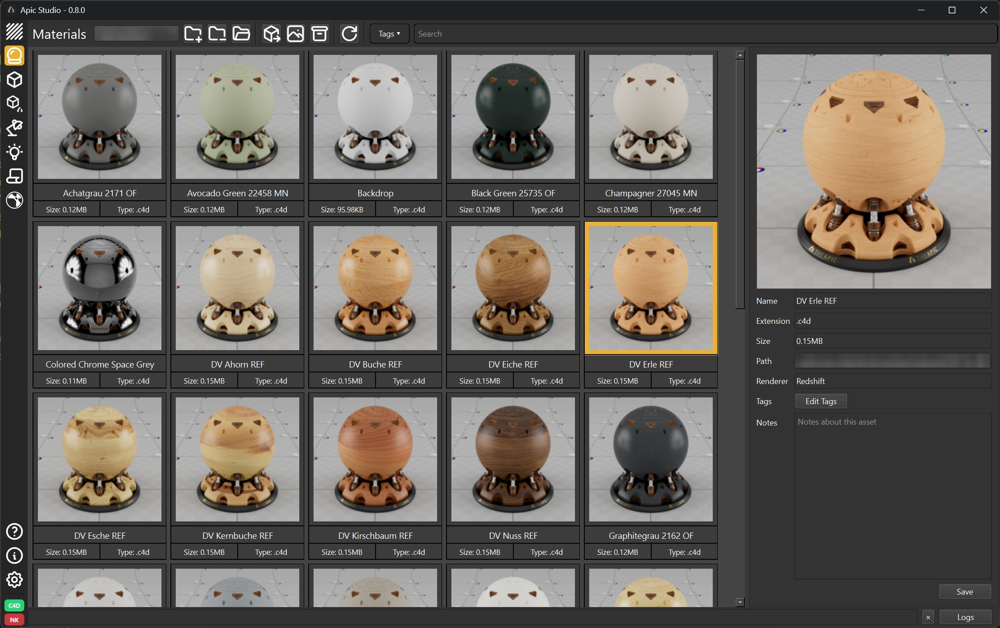
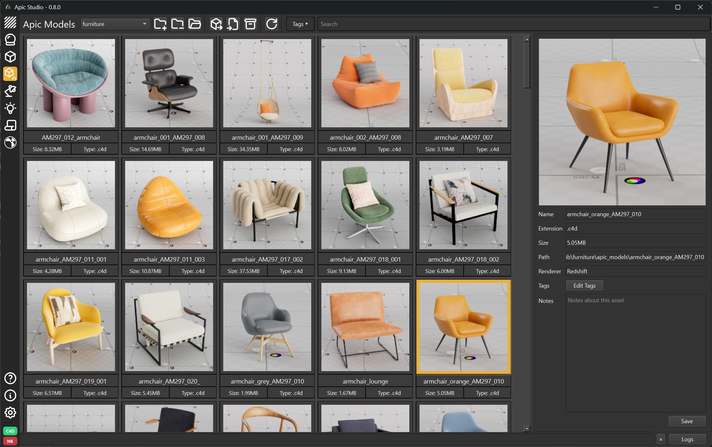
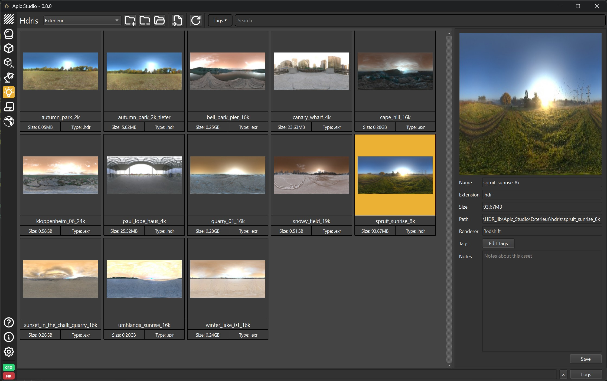
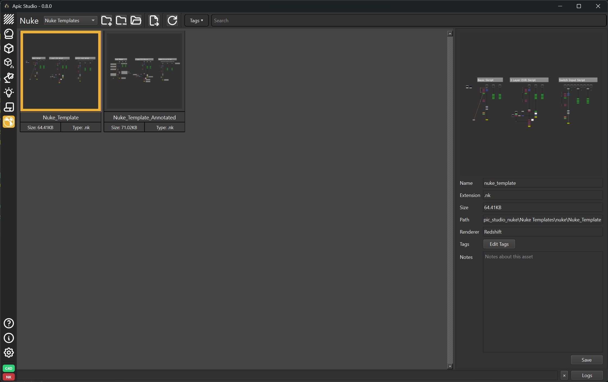

# Apic Studio

Asset browser for Cinema 4D and Nuke. Assets live in pools on disk, Apic Studio talks to the running DCC to import, export and render previews.






## Features

- Pools for materials, models, Apic models, lightsets, HDRIs, textures, render settings and Nuke scripts
- Cinema 4D: import, export and reference models, import/export materials, render material previews, load HDRIs as dome or area light, repath textures
- Render settings: save Cinema 4D and/or Redshift render settings to a pool and load them back into any scene
- Nuke: export the current comp to a pool, import scripts or open them in place
- Tags and notes per asset, filter by tags, rename or delete a tag across all pools
- Search, rename, delete, open in Explorer
- Archive/backups for models and materials, screenshot tool for thumbnails
- Details panel (`Ctrl+I`) and a log viewer
- Connection status for C4D and Nuke in the sidebar, click to reconnect

## Requirements

- **Operating System**: Windows is the primary supported platform (Cinema 4D integration assumes Windows paths). Some functionality may degrade on other platforms.
- **Cinema 4D**: Installed (the latest installation under `C:\Program Files\Maxon Cinema 4D*` is autodetected).

## Installation / Setup

### Prebuild Version

1. Copy "apic_connector_main.pyp" to <Maxon Cinema 4D 20XX>/plugins/apic_connector
   or set the "g_additionalModulePath" Environment variable to the directory that contains the .pyp file.

2. Create a directory and copy the "apic_connector" and "shared" modules over.

3. Set C4DPYTHONPATH311 Environment variable to the created directory.

4. Nuke (optional): put the directory on the Nuke plugin path and call `apic_connector.nuke.startup.start()` from your `init.py`. It listens on port 1338, change it with `APIC_NUKE_PORT` (has to match the Nuke port in the settings).

5. Run "Apic Studio.exe"

---

### Run from source

#### Requirements

- **Python 3.15**
- **rustup toolchain**
- **UV Package Manager**
- **Make** [Optional]

#### Installation

1. Clone repository

2. Run

```bash
Make run

[or]

uv run src/apic_studio.py
```

3. Build executable

```bash
make build

[or]

uv run build.py
```

## Future Improvements

- Cross-platform Cinema 4D detection
- Better error messages in dialogs
